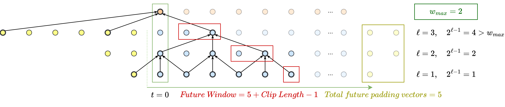

# Where to Spend the Future: 3D Clip Features under Bounded-Future Mechanism for Surgical Workflow Recognition

[](https://www.python.org/downloads/)
[](https://pytorch.org/)
[](LICENSE)

Official implementation of X3D-BF: 3D clip features (X3D-L) under the bounded-future MS-TCN++ for semi-causal surgical workflow recognition.

## 📄 Paper

**Where to Spend the Future: 3D Clip Features under Bounded-Future Mechanism for Surgical Workflow Recognition**

📎 *Paper link: TBD (Under Review)*

### Abstract

> This repository contains the code for training and evaluating EfficientNetV2-M and X3D-L feature extractors combined with bounded-future (BF) and reduced-receptive-field (RR) MS-TCN++ heads. Delay is counted over the whole pipeline: future frames inside each X3D clip (FCL) plus the future receptive field of the temporal head. Experiments cover JIGSAWS, SAR-RARP50, MultiBypass140 (steps and phases) and VTS.

## 🎯 Key Features

- X3D-L clip features (6.1M parameters) with a BF or RR MS-TCN++ head
- Controllable look-ahead through w_max and the future clip length (FCL); strictly causal when both are 0
- Fold splits for all four datasets, including our SAR-RARP50 split
- Supports JIGSAWS, VTS, SAR-RARP50 and MultiBypass140

## 🏗️ Architecture

### Temporal Model Overview

The X3D-BF architecture consists of a prediction-generation stage with $L_{PG}$ dual-dilated residual layers (DDRLs) followed by $K$ refinement stages, each with $L_R$ dilated residual layers (DRLs). Future context is limited by $w_{max}$.


### Temporal Configurations

| Configuration | Description |
|--------------|-------------|
| **Causal** | No future context ($w_{max}=0$) |
| **RR (Reduced Receptive Field)** | Symmetric past/future reduction |
| **BF (Bounded Future)** | Limited future window, keeping past context |
| **Acausal/Offline** | Full access to past and future |

**BF preserves long past context while constraining the future window, enabling semi-causal inference with minimal performance loss.**

### Receptive Field Calculation

The future receptive field for BF models is calculated as:

$$FW = FCL + PG_{future} + K \cdot R_{future}$$

Where:
- $FCL$ = Future Clip Length (0 for 2D, varies for X3D)
- $PG_{future} = \sum_{\ell=1}^{L} \max\{\min(2^{\ell-1}, w_{max}), \min(2^{L-\ell}, w_{max})\}$
- $R_{future} = \sum_{\ell=1}^{L} \min(2^{\ell-1}, w_{max})$



## 📊 Supported Datasets

| Dataset | #Videos | FPS | Label Rate | Classes | Task |
|---------|---------|-----|------------|---------|------|
| **JIGSAWS** | 39 | 30 | 30 | 10 | Gestures |
| **MultiBypass140** | 140 | 25 | 1 | 46/12 | Steps/Phases |
| **SAR-RARP50** | 50 | 60 | 10 | 8 | Gestures |
| **VTS** | 48 | 30 | 30 | 6 | Gestures |

## 📈 Results

### Comparison with published results on MultiBypass140

| Method | Mode | Accuracy | F1 (%) |
|--------|------|----------|--------|
| **Steps Task** | | | |
| MTMS-TCN | Causal | 72.85 | 52.69 |
| TeCNO | Causal | 73.49 | 53.08 |
| **X3D-BF (Ours)** | Causal | **75.94** | **55.05** |
| **X3D (Ours)** | Offline | 79.36 | 63.58 |
| **Phases Task** | | | |
| TeCNO | Causal | 86.44 | 71.03 |
| MTMS-TCN | Causal | 87.91 | 71.28 |
| MTTR-Net | Causal | 89.7 | **83.0** |
| **X3D-BF (Ours)** | Causal | **89.97** | 76.83 |
| **X3D (Ours)** | Offline | 91.57 | 79.76 |

Causal: no access to future frames (FCL=0, w_max=0). All prior methods are causal, so the causal X3D-BF row is the like-for-like comparison; the offline row is an upper bound.

### Key Findings

- 3D vs 2D: on JIGSAWS, X3D-L gives the best Accuracy and F1@50 at every future window (up to +11.6 F1@50); on SAR-RARP50, up to +8.8 F1-Macro; on VTS (low motion) the 2D backbone remains better.
- BF vs RR: BF generally matches or exceeds RR in Accuracy and F1@50; RR is sometimes ahead on Edit/F1@10/25 at larger windows and on VTS.
- FCL: Accuracy, F1-Macro and F1@50 improve up to about 10-13 future clip frames, then level off.
- Future window: most of the gain is obtained with small windows (JIGSAWS Edit 71.1 at 0 s, 78.8 at 6 s, 81.8 at 10 s).

## 📁 Project Structure

```
├── XBF_trainer.py         # Temporal head training (BF / RR MS-TCN++) on cached features
├── 3D_trainer.py          # Backbone fine-tuning and feature caching (X3D, EfficientNetV2)
├── 2D_trainer.py          # Legacy 2D-only backbone script (EfficientNetV2-M)
├── batch_gen.py           # Data loading and batch generation
├── BoundedFuture.yml      # Conda environment file
├── data/                  # Dataset directory
│   ├── JIGSAWS/
│   ├── VTS/
│   ├── SAR_RARP50/
│   └── MultiBypass140/
├── utils/                 # Core BF-MS-TCN++ utilities
│   ├── model.py           # MS-TCN++ model architectures
│   ├── Trainer.py         # Training loop and evaluation
│   └── MetricsBoundedFuture.py
├── utils_2D/              # 2D feature extractor utilities
├── utils_3D/              # 3D feature extractor utilities (X3D)
└── figs/                  # Figures and demo videos
```

## 🚀 Getting Started

### Prerequisites

- Python 3.9+
- CUDA-capable GPU
- conda (recommended)

### Installation

1. **Clone the repository**
   ```bash
   git clone https://github.com/gozalg/X3D-BF-Surgical-Workflow.git
   cd X3D-BF-Surgical-Workflow
   ```

2. **Create environment**
   ```bash
   conda env create -f BoundedFuture.yml
   conda activate BoundedFuture
   ```

3. **Set up Weights & Biases (optional)**
   ```bash
   export WANDB_API_KEY="your_api_key_here"
   ```

### Dataset Setup

```
data/
├── JIGSAWS/
│   ├── frames/              # Video frames
│   ├── transcriptions/      # Gesture annotations
│   ├── features/
│   │   ├── X3D-L/           # Pre-extracted X3D features
│   │   └── EfficientNetV2-M/
│   ├── folds/               # Cross-validation splits
│   └── Splits/
```

## 🎓 Training

Training has three steps: (1) fine-tune a backbone per fold, (2) cache its per-frame features, (3) train the temporal head on the cached features. Scripts run all folds unless `--split_num` (backbone) or `--split` (head) is given. Weights & Biases logging is off by default (`--wandb True` for the backbone, `--upload True` for the head).

### 1. Fine-tune the backbone

X3D-L (3D clip backbone; the labelled frame is the last of the 16-frame clip, i.e. FCL=0):

```bash
python 3D_trainer.py \
    --dataset JIGSAWS \
    --task gestures \
    --arch X3D --arch_size L \
    --clip_length_past 15 \
    --clip_length_future 0
```

EfficientNetV2-M (2D frame backbone): same script with `--arch EfficientNetV2 --arch_size M`.

Other datasets: `--dataset SAR_RARP50`, `--dataset VTS`, or `--dataset MultiBypass140 --task steps|phases`. The number of classes and data paths follow `--dataset`. For the FCL sweep, keep `clip_length_past + clip_length_future = 15` (e.g. `--clip_length_past 5 --clip_length_future 10` for FCL=10).

### 2. Cache features

Features are written at the end of training (`--save_features True`, default) to

```
data/<dataset>/features/X3D-L/<task>/pst<P>_ftr<F>/fold <k>/<video>.npy
data/<dataset>/features/EfficientNetV2-M/<task>/fold <k>/<video>.npy
```

To re-extract from a trained fold without retraining:

```bash
python 3D_trainer.py --dataset JIGSAWS --task gestures --arch X3D --arch_size L \
    --clip_length_past 15 --clip_length_future 0 \
    --extract_features_only True \
    --resume_exp output/feature_extractor/JIGSAWS/X3D-L/gestures_epochs_100_pst15_ftr0/0
```

### 3. Train the temporal head (BF / RR MS-TCN++)

Causal X3D-BF (no future frames):

```bash
python XBF_trainer.py \
    --dataset JIGSAWS \
    --task gestures \
    --feature_extractor X3D-L --features_dim 192 \
    --clip_length_past 15 --clip_length_future 0 \
    --RR_or_BF_mode BF --w_max 0 \
    --num_layers_PG 10 --num_layers_R 10 --num_R 3 \
    --split all
```

- **BF (bounded future):** `--RR_or_BF_mode BF --w_max W`. Each layer looks at most `min(W, dilation)` frames ahead; `W=0` is causal.
- **RR (reduced receptive field):** `--RR_or_BF_mode RR --num_layers_PG L --num_layers_R L`. Padding is symmetric, so the future window is set by `L`; `--w_max` is ignored.
- **Offline:** `--RR_or_BF_mode RR --num_layers_PG 10 --num_layers_R 10` (full symmetric receptive field).
- **EfficientNetV2-M features:** `--feature_extractor EfficientNetV2-M --features_dim 1280`.

Results (per-fold CSVs and predictions) are written to `output/summaries/<dataset>/<feature_extractor>/<task>/`.

### Key Arguments

| Script | Argument | Description | Default |
|--------|----------|-------------|---------|
| both | `--dataset` | VTS, JIGSAWS, MultiBypass140, SAR_RARP50 | JIGSAWS (3D_trainer), MultiBypass140 (XBF_trainer) |
| both | `--task` | gestures, steps, phases | gestures |
| both | `--clip_length_past` / `--clip_length_future` | Frames before / after the labelled frame in the X3D clip (sum = 15; future = FCL) | 15 / 0 |
| 3D_trainer | `--arch`, `--arch_size` | X3D + L, or EfficientNetV2 + M | X3D, L |
| 3D_trainer | `--seed` | Random seed | 1538574472 (paper) |
| XBF_trainer | `--RR_or_BF_mode` | RR or BF | BF |
| XBF_trainer | `--w_max` | BF future window per layer (0 = causal) | 20 |
| XBF_trainer | `--num_layers_PG`, `--num_layers_R`, `--num_R` | Layers per stage, refinement stages | 10, 10, 3 |
| XBF_trainer | `--upload`, `--save_model` | W&B logging, write checkpoints to disk | False, False |

Model selection: the epoch with the best validation F1@50 is tested; JIGSAWS has no validation split, so the last epoch is used. The temporal head draws its seed from the clock; the seed is printed and logged with each run.

## 🎥 Demo Video

A JIGSAWS example is provided as Online Resource 2 of the paper (JIGSAWS videos cannot be redistributed here).

### VTS Gesture Recognition

https://github.com/user-attachments/assets/cbfe8932-a9e4-4d68-855e-854cb8725fe6

## 📏 Evaluation Metrics

| Metric | Description |
|--------|-------------|
| **Accuracy** | Frame-wise classification accuracy |
| **F1-Macro** | Unweighted mean of per-class F1 scores |
| **Edit Score** | Normalized Levenshtein distance for segment ordering |
| **F1@k** | Segmental F1 at IoU thresholds k ∈ {10, 25, 50}% |

## 📝 Citation

If you use this code in your research, please cite:

```bibtex
@article{gozal2027where,
  title   = {Where to Spend the Future: 3D Clip Features under Bounded-Future Mechanism for Surgical Workflow Recognition},
  author  = {Gozal, Gabriel and Goldbraikh, Adam and Laufer, Shlomi},
  journal = {Under review},
  year    = {2027}
}
```

## 📧 Contact

For questions or issues, please open a GitHub issue.

## 📄 License

This project is licensed under the MIT License - see the [LICENSE](LICENSE) file for details.


## Data and licences

Videos are not included. Download them from the original sources and follow their terms:

- **JIGSAWS**: academic, non-commercial use; registration required at the [JHU CIRL page](https://cirl.lcsr.jhu.edu/research/hmm/datasets/jigsaws_release/). JIGSAWS transcriptions are not redistributed here; after registering, copy `transcriptions/Suturing_*.txt` into `data/JIGSAWS/transcriptions/`.
- **MultiBypass140**: [CC BY-NC-SA 4.0](https://creativecommons.org/licenses/by-nc-sa/4.0/), from [CAMMA-public/MultiBypass140](https://github.com/CAMMA-public/MultiBypass140).
- **SAR-RARP50**: [CC BY-NC-SA 4.0](https://creativecommons.org/licenses/by-nc-sa/4.0/), from the [UCL Research Data Repository](https://rdr.ucl.ac.uk/articles/dataset/SAR-RARP50_train_set/24932529).
- **VTS**: available from the authors of Goldbraikh et al. (2022).

The MultiBypass140 and SAR-RARP50 annotation files under `data/` are redistributed from the original datasets under CC BY-NC-SA 4.0 (non-commercial, share-alike, with attribution to the original authors), as is our SAR-RARP50 5-fold split. The MIT License applies to the code only.
